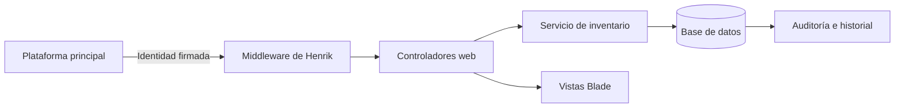

# Arquitectura

Henrik usa Laravel 13 y separa las reglas de inventario de la interfaz. `InventoryService` realiza los movimientos dentro de transacciones; los modelos mantienen relaciones y auditoría; los controladores validan las solicitudes; Blade presenta la interfaz.

## Entidades

| Entidad | Responsabilidad |
|---|---|
| `item_types` | Tipos configurables del catálogo. |
| `items` | Catálogo de artículos y su ubicación principal asignada. |
| `service_areas` | Áreas para las que puede servir un artículo. |
| `locations` | Árbol de sedes, edificios, oficinas, bodegas y zonas. |
| `stocks` | Cantidad de un artículo en una ubicación. |
| `assets` | Unidad identificable por etiqueta o número de serie. |
| `stock_movements` | Registro de entradas, salidas y traslados; las recepciones admiten correcciones auditadas. |
| `audit_logs` | Antes/después y responsable de los cambios. |

## Modularidad

- La autenticación está encapsulada en `AuthenticatePlatformRequest`.
- Las reglas de stock están en `InventoryService` y no dependen de las vistas.
- Los nombres de áreas y ubicaciones son datos configurables.
- La base de datos se construye con migraciones portables.
- Un futuro cliente o API puede reutilizar los mismos modelos y servicios.

## Versionado

- Git conserva las versiones del código.
- `CHANGELOG.md` documenta cambios funcionales.
- `audit_logs` conserva versiones operativas de los datos.
- Las futuras integraciones HTTP usarán una ruta versionada, comenzando en `/api/v1`.
